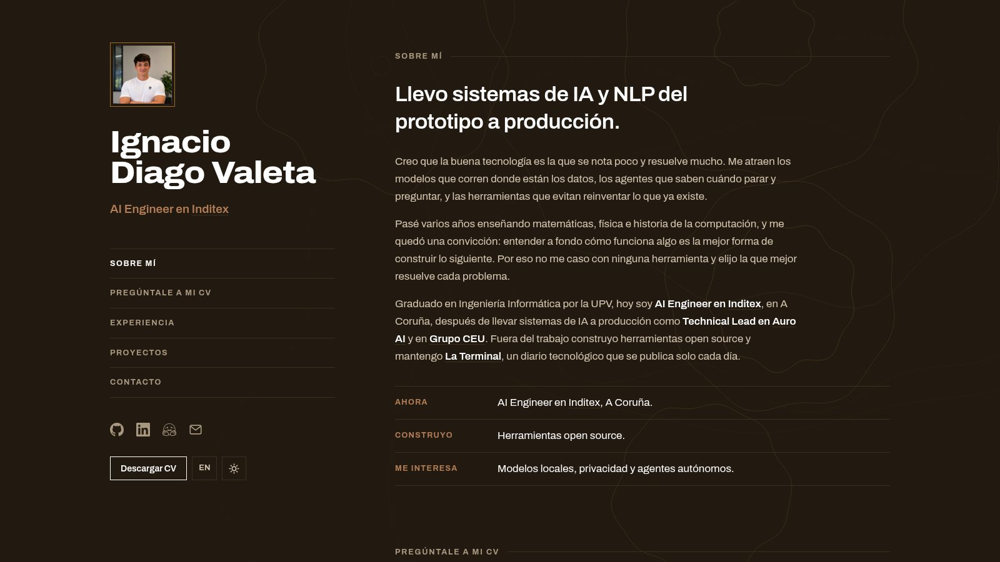

# Ignacio Diago Valeta, portfolio

Personal portfolio of Ignacio Diago Valeta, AI Engineer at Inditex, with an assistant that answers recruiters' questions straight from his CV.

- **Live site:** [portfolio-chat-aouj.onrender.com](https://portfolio-chat-aouj.onrender.com/)
- **CV:** [resume.pdf](resume.pdf)
- **LinkedIn:** [Ignacio Diago Valeta](https://www.linkedin.com/in/ignacio-diago-valeta-1234567891011121314/)
- **Hugging Face:** [nadiva1243](https://huggingface.co/nadiva1243)



## Why it exists

Reviewing a candidate usually means skimming a PDF and guessing how their experience maps to the role. This site lets a reviewer ask the CV directly: an assistant grounded only in Ignacio's real experience answers fit, seniority and project questions in the visitor's language, and says so when something is not in his profile.

## Features

- **Ask my CV**: a streaming chat grounded in `config.js`. It maps experience to job requirements, answers behavioural questions with real cases and declines to guess salary, availability or anything it does not know.
- **Selected work**: four projects whose previews link straight to their repositories.
- **Bilingual**: Spanish and English, switchable at any time.
- **Dark and light themes**: dark by default, with a persisted toggle.
- **Responsive**: checked from 320 px to 1920 px with no horizontal overflow.
- **Fast in every browser**: 60 fps idle, scrolling and with pointer movement in Chromium, also with the CPU slowed 4x.
- **No dependencies**: no npm, no build step, no CDNs. Fonts and assets are served from the repository.

## How it works

```text
Browser (app.js)
  -> POST /api/chat  { messages: [...] }          only the conversation
     portfolio/web.py      HTTP adapter: size cap (100 KB), status codes, SSE pass-through
     portfolio/chat.py     core: validates roles and length, rate limits
                           (6/min and 40/day per visitor, 600/day in total)
     portfolio/ports.py    ChatModel port
     portfolio/deepseek.py adapter: fixes model and parameters
       -> DeepSeek Chat Completions (stream)
     <- Server-Sent Events, forwarded as they arrive
  <- renders delta.content, ignores reasoning tokens, sanitizes the HTML
```

| Path | Role |
| --- | --- |
| `index.html` | Page shell, SEO metadata, Open Graph and JSON-LD |
| `styles.css` | The whole visual system: tokens, layout and responsive rules |
| `app.js` | Bilingual copy, rendering, the chat client and the wave background |
| `config.js` | The assistant's knowledge and answering rules (the system prompt) |
| `server.py` | Composition root: reads the key and `config.js`, wires the pieces and starts the server |
| `portfolio/` | Chat backend in ports and adapters: core (`chat.py`), port (`ports.py`), HTTP adapter (`web.py`), DeepSeek adapter (`deepseek.py`). Python standard library only |
| `tests/` | Core, adapter and architecture-contract tests, with an in-memory chat model |
| `PRODUCT.md`, `DESIGN.md` | Product context and the design system |
| `AGENTS.md` | Working rules for coding agents |

## Security

- The DeepSeek key never reaches the browser; the server reads it from `DEEPSEEK_API_KEY`.
- The server owns the model, the generation parameters and the system prompt. The browser can send user and assistant turns only, so the endpoint cannot be used as open access to the API.
- Visitors are identified by `True-Client-IP` (set by Cloudflare in front of Render). Limits are kept in memory and reset when the service restarts.
- Only the site's own files are served (an allow list in `portfolio/web.py`); source code, documentation and `.git` answer 404.
- Assistant output is rendered through a tag allow list; user text is inserted as plain text.

## Run locally

```bash
export DEEPSEEK_API_KEY="your_api_key"   # or put it in a local .env file
python3 server.py                        # PORT=8001 python3 server.py to change the port
```

Then open <http://localhost:8000>. Without a key the site works and the chat answers with an error.

## Tests

```bash
python3 -m unittest discover -s tests -t .
```

They need no key and no network: the chat model is replaced by an in-memory double and DeepSeek by a local fake server. `tests/test_architecture.py` reads `.hexagonal.json` and fails if the core or the port import network, HTTP or adapter code. CI runs them on every pull request.

## Deployment

[Render](https://render.com) runs `python server.py` (see `Procfile`) and redeploys on every push to `main`. `DEEPSEEK_API_KEY` is set in the Render dashboard.

## Contributing

Trunk-based: short branches off `main`, one topic per pull request, [Conventional Commits](https://www.conventionalcommits.org/) titles. The pull request template lists what to check before merging.

## License

[MIT](LICENSE)
